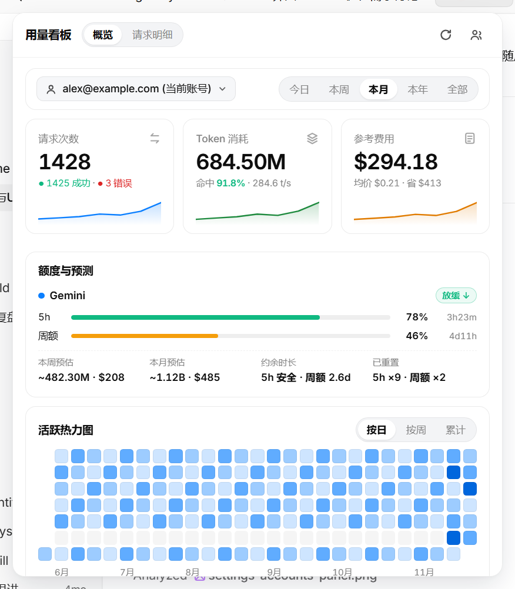
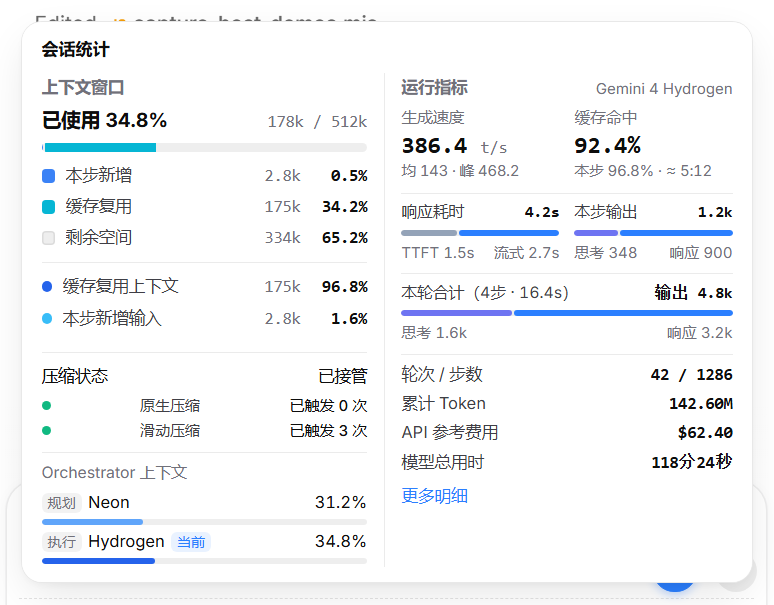
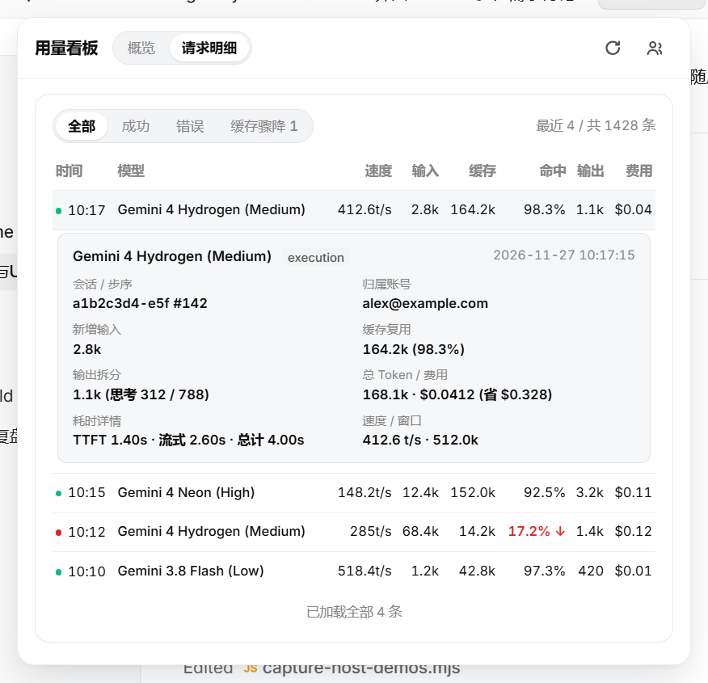

<div align="center">

<h1>antigravity-theme</h1>

<p><strong>Google Antigravity 的 Codex 昼夜主题、智能额度预测看板、本地 Flow 滑动压缩接管与中文增强套件</strong></p>

<p>
  <a href="#界面预览">界面预览</a> ·
  <a href="#核心能力">核心能力</a> ·
  <a href="#功能全景">功能全景</a> ·
  <a href="#快速安装">快速安装</a> ·
  <a href="#自定义与运维">自定义与运维</a> ·
  <a href="#致谢与参考">致谢与参考</a> ·
  <a href="#english-overview">English</a>
</p>

<p>
  
  = 22.13.0">
  
  
  <a href="LICENSE"></a>
</p>

<p>
  <a href="#界面预览"></a>
  <a href="#ai-一键引导安装"></a>
  <a href="#命令行安装"></a>
</p>

</div>

> 通过本机 CDP 热注入与轻量本地 Flow 代理运行，不修改客户端界面资源结构；统计账单、请求明细与多账号凭据全部留存本地，支持 `--only` 按需安装与设置面板内热重载。

---

## 界面预览

<table>
  <tr>
    <th width="50%">智能额度预测 & 统一用量看板</th>
    <th width="50%">本地 Flow 滑动压缩接管 & 双栏遥测</th>
  </tr>
  <tr>
    <td>
      
      <p>实时跟踪 5 小时 / 7 天双窗口、60 分钟滑窗燃速与 Empirical Bayes 冷启动预测，配合 3-Card KPI 趋势与 24 小时活动热力图。</p>
    </td>
    <td>
      
      <p>左侧拆分展示上下文窗口占比与真实压缩接管状态（原生压缩 / 滑动压缩），右侧汇总生成速度、缓存命中、思考与正文拆分。</p>
    </td>
  </tr>
  <tr>
    <th>无限滚动请求明细 & 8 维单次诊断</th>
    <th>5 Tab 增强设置 & 多账号凭据库</th>
  </tr>
  <tr>
    <td>
      
      <p>解除 200 条硬截断实现无感滚动加载，行内以极简红绿圆点标示状态与缓存骤降，点击任意记录原地展开 8 维单次诊断。</p>
    </td>
    <td>
      
      <p>原生嵌入 Antigravity 设置弹窗，集中管理 OAuth2 多账号捕获、防串写切换、低额度自动切号及全套主题/代理/汉化开关。</p>
    </td>
  </tr>
</table>

<details>
<summary>展开查看：Codex 纯白浅色与炭灰深色双主题对比</summary>


</details>

---

## 核心能力

### 1. 智能额度预测 & 统一用量看板

将本地 SQLite 会话账单与后台实时采样序列融合，直观掌握多模型池额度消耗节奏：

- **5h / 7 天混合额度预测**：采用 60 分钟活跃滑窗燃速 + Empirical Bayes 冷启动平滑，结合 7 天均匀先验稳健推算约余时长（`5h 安全 · 周额 X.Xd`），避免刚切号或单日冲刺引发恐慌误报。
- **独立周窗、跨月隔离与重置追踪**：按 `weeklyResetTime - 7d` 精确隔离本轮周消耗基数，周预估与自然月预估独立计算；支持官方手工/全员提前重置与建档前重置识别，准确记录 `5h ×N · 周额 ×M`。
- **顶栏 8 阶动态呼吸彩点**：支持「剩余额度 / 当前会话 / 今日用量 / 本月用量 / 本月费用 / 纯图标」6 种显示模式，圆点、光环与字体同步呈现 8 阶梯度色带（翠绿 → 青绿 → 晴蓝 → 靛紫 → 金黄 → 炽橙 → 绯红 → 深玫红），生成中自动加快呼吸频率。
- **单行自适应 KPI 与无限滚动明细**：`fitSingleLineNodes` 自动微缩溢出副标题确保单行零截断；请求明细支持无感滚动加载与状态/缓存骤降筛选。

### 2. 本地 Flow 滑动压缩代理接管

通过轻量级本地 Flow 代理与最小化入口路由接管，在不打断长链路任务的前提下稳定托管上下文窗口：

- **自动增量滑动压缩**：按模型真实上下文上限（512k / 200k）判定阈值（默认 `70%` / `80%`），后台自动汇总早期历史并保留最近安全尾窗，严格保护 `functionCall` / `functionResponse` 工具调用链不被拆散，支持多轮增量接力与原子回滚。
- **原生压缩接管与主会话绑定**：拦截并改写客户端原生 `/compact` 提示词；通过 `trajectory_meta` 双向映射精准锁定主会话，不受系统提示词中 `<subagents>` 文档干扰。
- **长连接保活与自愈守护**：解除 Node.js 默认 5 分钟请求超时与短 KeepAlive 限制，支持首包前瞬断自动重连、异常退避自愈及看门狗二次复核防误杀。

---

## 功能全景

| 模块 | 核心能力 | 默认状态 |
| :--- | :--- | :--- |
| **Codex 昼夜主题** | 纯白浅色 (`codex-pure-white`) 与中性炭灰深色 (`codex-dark`)，随系统外观自动同步 | 默认开启 |
| **额度预测与用量看板** | 顶栏 8 阶呼吸彩点、3-Card KPI 趋势、5h/7 天混合预测、24h 热力图与无限滚动请求明细 | 默认内置 |
| **Flow 代理与滑动压缩** | 本地代理接管、自动增量滑动压缩、原生压缩改写、长连接保活与子智能体模型路由 | 按需开启接管 |
| **多账号凭据库管理** | 凭据捕获、OAuth2 回环登录、防串写 `pendingSwitch` 切换、低额度自动切号与平滑重启 | 默认内置 |
| **会话统计与状态机** | 输入框底栏紧凑胶囊、四态指示灯、双栏悬浮详情卡（支持可选 **SSH Remote** 远端只读统计） | 默认开启（SSH 可选） |
| **中文系界面本地化** | 融合精校 `3,000+` 词条，支持 **简体中文 (`zh-CN`) / 英文术语简中 (`zh-SG`) / 繁體中文 (`zh-TW`) / 英文** 即时切换，含分支/项目名防误译守卫 | 默认开启 |
| **嵌入式增强设置面板** | 原生设置内 5 Tab 面板（外观与状态 / 账号管理 / 提示词与权限 / 代理与恢复 / 扩展与更新），实时热重载 | 默认内置 |
| **系统级提示词与 Hooks** | 无损托管 `GEMINI.md`、`rules/*.md` 与 `hooks.json`；输入框 Ghost Text 下一句预测（可选） | 默认关闭（按需开启） |

---

## 快速安装

> **前置要求**：**Node.js >= 22.13.0**（见 [package.json](package.json)），已在 **macOS / Windows / Linux** 桌面端验证。插件部署至 `~/.gemini/antigravity/codex-theme`，支持开机自启与热更新；若安装前客户端未开启调试端口，执行 `node install.mjs relaunch` 即可生效。

### AI 一键引导安装

将以下引导词直接发送给你的 AI Agent（Antigravity / Claude Code / Codex 等）：

> 请克隆 `https://github.com/XziXmn/antigravity-theme.git`，先阅读仓库根目录的 `SKILL.md`，然后按顺序执行 `node install.mjs install` 与 `node --disable-warning=ExperimentalWarning install.mjs doctor`。如果我在 Antigravity 内部对话中运行且需要重启以开启调试端口，请不要强行中断当前会话，只需提醒我在空闲时运行 `node install.mjs relaunch`。

### 命令行安装

```bash
git clone https://github.com/XziXmn/antigravity-theme.git
cd antigravity-theme
node install.mjs install
node --disable-warning=ExperimentalWarning install.mjs doctor
```

### 按需精简安装（`--only`）

支持从 `theme`、`i18n`、`metrics`、`fixes`（默认）和 `suggest`（可选）中按需组合，也可通过 `sparse-checkout` 跳过 `assets/` 与 `tests/`：

```bash
git clone --depth=1 --filter=blob:none --sparse https://github.com/XziXmn/antigravity-theme.git
cd antigravity-theme
git sparse-checkout set core user
node install.mjs install --only theme,i18n,metrics
```

<details>
<summary>展开查看：常用运维、更新、同步词库、回滚与卸载命令</summary>

| 命令 | 用途 |
| :--- | :--- |
| `node install.mjs install [--channel auto\|stable\|insiders] [--only <features>] [--minimal]` | 部署插件并注册后台守护服务 |
| `node install.mjs update [--check] [--ref <branch\|tag>]` | 检查更新并升级（自动校验完整性、备份 `core.prev/`，保留 `user/`） |
| `node install.mjs relaunch [--channel auto\|stable\|insiders] [--force]` | 携带调试端口重启客户端并校验注入（含活跃会话保护） |
| `node --disable-warning=ExperimentalWarning install.mjs doctor` | 检查 Node 环境、CDP 状态、`core/manifest.json` 哈希及页面挂载 |
| `node install.mjs sync-i18n` / `npm run sync-i18n` | 同步上游中文词库与 `core/upstreams.json` |
| `node install.mjs rollback` | 回滚至上一份备份的 `core/` 版本 |
| `node install.mjs uninstall` | 停止服务、清理自启项与代理配置，恢复原生英文界面与样式 |
| `node install.mjs build-manifest && npm run check && npm test` | 重建 `62` 个核心文件清单、校验全量语法并运行 `node:test` 单元测试 |

</details>

---

## 自定义与运维

- **日常可视化配置**：直接在 Antigravity **设置 → 增强设置** 中切换主题、顶栏指标模式、Flow 滑动压缩阈值、多账号自动切换与系统提示词/Hooks，保存后实时写入 `~/.gemini/antigravity/codex-theme/user/config.json`，升级插件时不会覆盖 `user/`。
- **源码定制与构建**：核心模块共 `62` 个文件（`core/daemon/`、`core/flow/`、`core/runtime/`、`core/styles/`、`core/installer/`、`core/i18n/`），修改后执行以下命令构建清单、校验测试并部署：

```bash
node install.mjs build-manifest && npm run check && npm test && node install.mjs install
```

---

## 致谢与参考

本项目的诞生与持续演进离不开以下优秀开源参考项目与社区贡献者，特此致谢（机器可读同步清单见 [`UPSTREAMS.md`](UPSTREAMS.md) 与 [`core/upstreams.json`](core/upstreams.json)）：

- **[nkjDSLcvanv/antigravity-codex-theme](https://github.com/nkjDSLcvanv/antigravity-codex-theme)**（MIT）：提供 Codex 昼夜主题配色、CDP 守护进程基础架构、四态状态机与嵌入式设置面板核心框架。
- **[WhiteBr1ck/agy-powertools](https://github.com/WhiteBr1ck/agy-powertools)**（MIT）：提供上下文窗口细粒度拆解、双栏会话统计弹窗、OS 凭据库防串写 `pendingSwitch`、Windows 无黑窗自动重启及本地用量/缓存骤降分析参考。
- **[CHANPAJN/antigravity-langpack](https://github.com/CHANPAJN/antigravity-langpack)**（GPL-3.0）：提供高质量简体中文（`zh-CN`）、英文术语简中（`zh-SG`）与繁體中文（`zh-TW`）主词库及语言联动规则规范。
- **[guuguo/antigravity-zh-launcher](https://github.com/guuguo/antigravity-zh-launcher)**（MIT）：提供通用 IDE 菜单补充词条与聊天正文防误伤 DOM 隔离规则。
- **[Anarcadia/chuanban-antigravity-theme-patch](https://github.com/Anarcadia/chuanban-antigravity-theme-patch)**（MIT）：提供早期 CDP 运行时注入原理、原生西文字体桥接与单图标冷启动接力调研启发。
- **[elviscjn-cjn/antigravity-context-viewer](https://github.com/elviscjn-cjn/antigravity-context-viewer)**（MIT）：提供 Google OAuth2 回环登录与多视图热力图设计参考。
- **社区贡献者**：感谢 `@isdou`（输入框下一句预测）、`@xiaoxiami-zyx`（SSH Remote 只读元数据提取）、`@chunbin1`（冷启动目标退避重试机制）对上游与本项目的贡献。

本项目遵循 **[GNU General Public License v3.0 (GPL-3.0)](LICENSE)** 开源，欢迎 Star、Fork 与反馈。

---

## English Overview

**antigravity-theme** is an enhancement suite for **Google Antigravity**, delivering a Codex light/dark theme, **hybrid 5h / 7-day quota forecasting & unified analytics**, **local Flow sliding-window compaction hijacking**, multi-account credential management, and multi-variant Chinese localization (`3,000+` entries) via local CDP injection without modifying app UI assets.

- **Quota Prediction & Analytics**: 60-minute sliding-window burn rate + Empirical Bayes cold-start smoothing, separated rolling 7-day vs calendar-month projections, manual/early reset detection, an 8-level breathing topbar badge, infinite-scroll request logs with 8-dimension per-request diagnostics, and a multi-account credential vault.
- **Sliding Compaction Proxy (Local Flow Engine)**: Intercepts main-session requests, protects `functionCall`/`functionResponse` pairs during incremental multi-round compaction with atomic rollback, hijacks native `/compact` prompts, and keeps long-lived upstream streams resilient.
- **Quick Start**: `git clone https://github.com/XziXmn/antigravity-theme.git && cd antigravity-theme && node install.mjs install` (requires **Node.js >= 22.13.0**).
- **Credits & License**: Built upon and inspired by `antigravity-codex-theme`, `agy-powertools`, `antigravity-langpack`, `antigravity-zh-launcher`, `chuanban-antigravity-theme-patch`, and `antigravity-context-viewer`. Licensed under **GPL-3.0**.
