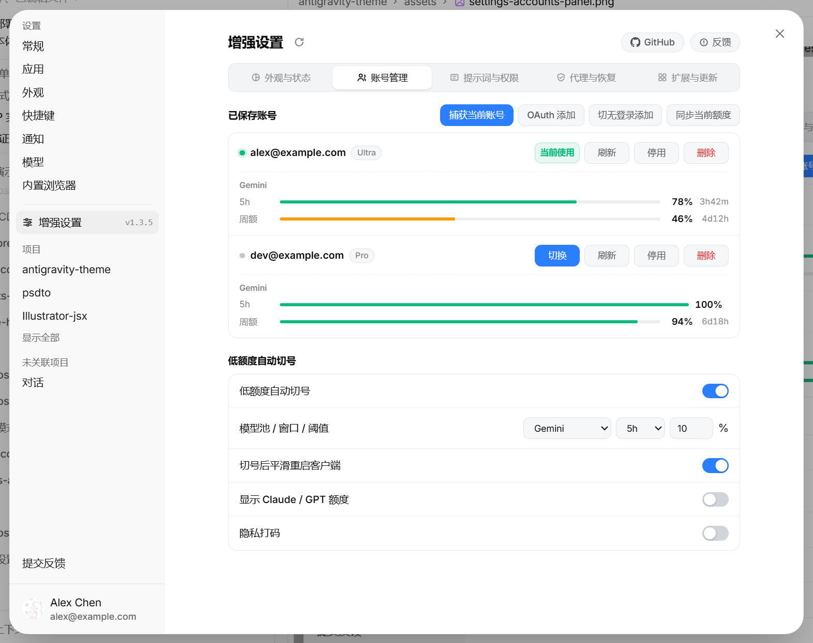

<div align="center">

<h1>antigravity-theme</h1>

<p><strong>面向 Google Antigravity 的 Codex 昼夜主题、智能额度预测看板、本地 Flow 滑动压缩接管与中文增强套件</strong></p>

<p>
  <a href="#核心亮点">核心亮点</a> ·
  <a href="#快速安装">快速安装</a> ·
  <a href="#功能全景">功能全景</a> ·
  <a href="#自定义与运维">自定义与运维</a> ·
  <a href="#致谢与参考项目">致谢与参考项目</a> ·
  <a href="#english-overview">English</a>
</p>

<p>
  通过本地 CDP 热注入与轻量级本地 Flow 代理，为 Google Antigravity 带来零闪烁 Codex 昼夜主题、<strong>5h / 7 天混合额度预测看板</strong>、<strong>无感增量滑动压缩接管</strong>、多账号凭据库管理、中文系多变体本地化与系统级 Hooks 托管。<br>
  全部模块高度解耦（<code>61</code> 个核心文件），支持 <code>--only</code> 按需安装、设置面板内检查更新与热重载生效。
</p>

<p>
  <a href="https://github.com/XziXmn/antigravity-theme/actions/workflows/ci.yml"></a>
  = 22.13.0">
  
  
  <a href="LICENSE"></a>
</p>

</div>

---

## 核心亮点

### 1. 智能额度预测 & 统一用量看板

告别「盲猜剩余额度」，将本地 SQLite 会话账单与后台实时采样序列深度融合：

- **5h / 7 天双窗口实时监控与混合预测**：
  - **60 分钟活跃滑窗燃速 + Empirical Bayes 冷启动平滑**：即使刚切换新账号或单日高强度冲刺，也能结合 7 天均匀先验稳健推算约余时长（`5h 安全 · 周额 X.Xd`），避免短时尖峰导致恐慌性误报。
  - **滚动 7 天周窗与自然月独立推算**：精确按 `weeklyResetTime - 7d` 隔离当前周消耗基数，跨月时不再混淆上周期历史；支持 **官方手工/提前全员重置** 与建档前周期重置识别，准确统计 `5h ×N · 周额 ×M`。
- **顶栏 8 阶动态呼吸彩点**：顶栏徽章支持「剩余额度 / 当前会话 / 今日用量 / 本月用量 / 本月费用 / 纯图标」6 种显示形态，圆点、光环与文字同步随用量呈现 **8 阶梯度色带**（翠绿 → 青绿 → 晴蓝 → 靛紫 → 金黄 → 炽橙 → 绯红 → 深玫红），生成中自动加快呼吸频率。
- **请求明细无感滚动 & 8 维单次诊断**：解除 200 条硬截断限制，下滑至底部自动无感追加渲染；用极简红绿圆点与行内红字标识异常/缓存骤降，点击任意行原地展开会话步序、归属账号、缓存命中、思考/正文拆分与 TTFT/流式耗时。


### 2. Codex 滑动压缩代理接管（本地 Flow 引擎）

内置轻量级本地 Flow 代理与 `asar` 最小化路由接管，在不中断长任务的前提下彻底接管上下文压缩：

- **自动增量滑动压缩**：当主会话接近阈值（默认 `70%` / `80%`，按模型真实 512k/200k 窗口精准判定）时，后台自动汇总早期历史并保留最近安全尾窗（保护 `functionCall` / `functionResponse` 工具调用链不被拆散），支持多轮增量接力压缩与原子级失败回滚。
- **原生压缩请求接管与主会话精准识别**：自动识别并改写客户端发出的原生 `/compact` 提示词；通过 `trajectory_meta` 双向映射精准绑定主会话（不受系统提示词 `<subagents>` 文档干扰），确保压缩策略稳定命中。
- **长连接保活与高可用守护**：解除 Node.js 默认 5 分钟请求超时与短 KeepAlive 限制，支持首包前瞬断自动重连重试、意外关闭退避自愈，以及看门狗二次复核防误杀。


---

## 功能全景

| 模块 | 核心能力 | 启用方式 |
| :--- | :--- | :--- |
| **Codex 昼夜主题** | 纯白浅色 (`codex-pure-white`) 与中性炭灰深色 (`codex-dark`)，随 IDE 外观自动切换 | 默认开启 |
| **额度预测与用量看板** | 顶栏 8 阶呼吸彩点、3-Card 面积折线、多模型池混合预测、热力图与无感滚动请求明细 | 默认内置 |
| **Flow 代理与滑动压缩** | 本地代理接管、自动增量滑动压缩、原生压缩改写、长连接保活与子智能体模型路由 | 按需开启接管 |
| **多账号凭据库管理** | 凭据捕获、OAuth2 回环登录、防串写 `pendingSwitch` 切换、低额度自动切号与无黑窗重启 | 默认内置 |
| **会话统计与状态机** | 输入框底栏紧凑胶囊、四态指示灯、双栏悬浮详情卡（支持可选 **SSH Remote** 远端只读统计） | 默认开启（SSH 可选） |
| **中文系界面本地化** | 融合精校 `2,300+` 词条，支持 **简体中文 (`zh-CN`) / 英文术语简中 (`zh-SG`) / 繁體中文 (`zh-TW`) / 英文** 即时切换 | 默认开启 |
| **嵌入式增强设置面板** | 原生设置内 5 Tab 面板（通用与界面 / 统计与输入 / Flow 与压缩 / 账号管理 / 提示词与更新），零闪烁热重载 | 默认内置 |
| **系统级提示词与 Hooks** | 无损托管 `GEMINI.md`、`rules/*.md` 与 `hooks.json`；输入框 Ghost Text 下一句预测（可选） | 默认关闭（按需开启） |

<details>
<summary>查看更多界面演示：请求明细诊断、账号管理与昼夜主题对比</summary>





</details>

---

## 快速安装

> **前置要求**：**Node.js >= 22.13.0**（见 [package.json](package.json)），已覆盖 **macOS / Windows / Linux** 桌面端验证。插件部署至 `~/.gemini/antigravity/codex-theme`，支持后台服务自启与热更新；若安装前客户端已在无调试端口状态下运行，执行 `node install.mjs relaunch` 即可生效。

### 命令行安装

```bash
git clone https://github.com/XziXmn/antigravity-theme.git
cd antigravity-theme
node install.mjs install
node --disable-warning=ExperimentalWarning install.mjs doctor
```

### 按需安装（`--only`）

支持从 `theme`、`i18n`、`metrics`、`fixes`（默认）以及 `suggest`（可选）中按需组合，或跳过 `assets/` 与 `tests/` 精简拉取：

```bash
git clone --depth=1 --filter=blob:none --sparse https://github.com/XziXmn/antigravity-theme.git
cd antigravity-theme
git sparse-checkout set core user
node install.mjs install --only theme,i18n,metrics
```

<details>
<summary>查看常用运维、更新、回滚与测试命令</summary>

| 命令 | 用途 |
| :--- | :--- |
| `node install.mjs install [--channel auto\|stable\|insiders] [--only <features>] [--minimal]` | 部署插件并注册后台守护服务 |
| `node install.mjs update [--check] [--ref <branch\|tag>]` | 检查更新并升级（自动校验完整性、备份 `core.prev/`，保留 `user/`） |
| `node install.mjs relaunch [--channel auto\|stable\|insiders] [--force]` | 携带调试端口重启客户端并校验注入（含活跃会话保护） |
| `node --disable-warning=ExperimentalWarning install.mjs doctor` | 检查 Node 环境、CDP 状态、`core/manifest.json` 哈希及页面挂载 |
| `node install.mjs sync-i18n` / `npm run sync-i18n` | 同步上游中文词库与 `core/upstreams.json` |
| `node install.mjs rollback` | 回滚至上一份备份的 `core/` 版本 |
| `node install.mjs uninstall` | 停止服务、清理自启项与代理配置，恢复原生英文界面与样式 |
| `node install.mjs build-manifest && npm run check && npm test` | 重建 `61` 个核心文件清单、校验全量语法并运行 `node:test` 单元测试 |

</details>

---

## 自定义与运维

- **日常可视化配置**：直接在 Antigravity **设置 → 增强设置** 中切换主题、顶栏指标模式、Flow 滑动压缩阈值、多账号自动切换与系统提示词/Hooks，保存后实时热重载写入 `~/.gemini/antigravity/codex-theme/user/config.json`，升级插件时不会覆盖 `user/`。
- **源码定制与构建**：核心代码共 `61` 个文件（`core/daemon/`、`core/flow/`、`core/runtime/`、`core/styles/`、`core/installer/`、`core/i18n/`），修改后执行以下命令构建清单、跑通全量测试并部署：

```bash
node install.mjs build-manifest && npm run check && npm test && node install.mjs install
```

---

## 致谢与参考项目

本项目的诞生与持续演进离不开以下优秀开源参考项目与社区贡献者，特此致以诚挚感谢（机器可读同步清单见 [`UPSTREAMS.md`](UPSTREAMS.md) 与 [`core/upstreams.json`](core/upstreams.json)）：

- **[nkjDSLcvanv/antigravity-codex-theme](https://github.com/nkjDSLcvanv/antigravity-codex-theme)**（MIT）：提供 Codex 昼夜主题配色、CDP 守护进程基础架构、四态状态机与嵌入式设置面板核心框架。
- **[WhiteBr1ck/agy-powertools](https://github.com/WhiteBr1ck/agy-powertools)**（MIT）：提供上下文窗口细粒度拆解、双栏会话统计弹窗、OS 凭据库防串写 `pendingSwitch`、Windows 无黑窗自动重启及本地用量/缓存骤降分析参考。
- **[CHANPAJN/antigravity-langpack](https://github.com/CHANPAJN/antigravity-langpack)**（GPL-3.0）：提供高质量简体中文（`zh-CN`）、英文术语简中（`zh-SG`）与繁體中文（`zh-TW`）主词库及语言联动规则规范。
- **[guuguo/antigravity-zh-launcher](https://github.com/guuguo/antigravity-zh-launcher)**（MIT）：提供通用 IDE 菜单补充词条与聊天正文防误伤 DOM 隔离规则。
- **[Anarcadia/chuanban-antigravity-theme-patch](https://github.com/Anarcadia/chuanban-antigravity-theme-patch)**（MIT）：提供早期 CDP 运行时注入原理、原生西文字体桥接与单图标冷启动接力调研启发。
- **[elviscjn-cjn/antigravity-context-viewer](https://github.com/elviscjn-cjn/antigravity-context-viewer)**（MIT）：提供 Google OAuth2 回环登录与多视图热力图设计参考。
- **社区贡献者**：感谢 `@isdou`（输入框下一句预测）、`@xiaoxiami-zyx`（SSH Remote 只读元数据提取）、`@chunbin1`（冷启动目标退避重试机制）通过 PR 对上游与本项目的贡献。

本项目遵循 **[GNU General Public License v3.0 (GPL-3.0)](LICENSE)** 开源，欢迎 Star、Fork 与反馈。

---

## English Overview

**antigravity-theme** is an enhancement suite for **Google Antigravity**, delivering a Codex light/dark theme, **hybrid 5h / 7-day quota forecasting & unified analytics**, **local Flow sliding-window compaction hijacking**, multi-account credential management, and multi-variant Chinese localization without modifying the app binary layout permanently.

- **Quota Prediction & Analytics**: 60-minute sliding-window burn rate + Empirical Bayes cold-start smoothing, separated rolling 7-day vs calendar-month projections, manual/early reset detection, an 8-level breathing topbar badge, infinite-scroll request logs with 8-dimension per-request diagnostics, and a multi-account credential vault.
- **Sliding Compaction Proxy (Local Flow Engine)**: Intercepts main-session requests, protects `functionCall`/`functionResponse` pairs during incremental multi-round compaction with atomic rollback, hijacks native compaction prompts, and keeps long-lived upstream streams resilient.
- **Quick Start**: `git clone https://github.com/XziXmn/antigravity-theme.git && cd antigravity-theme && node install.mjs install` (requires **Node.js >= 22.13.0**).
- **Credits & License**: Built upon and inspired by `antigravity-codex-theme`, `agy-powertools`, `antigravity-langpack`, `antigravity-zh-launcher`, `chuanban-antigravity-theme-patch`, and `antigravity-context-viewer`. Licensed under **GPL-3.0**.
